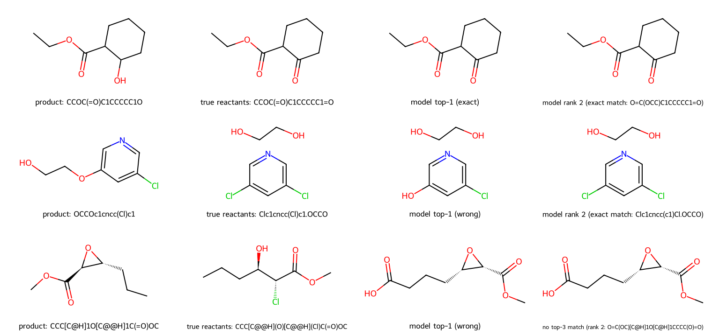

# rxn_smiles_gpt — retrosynthesis GPT on USPTO-50k

A decoder-only GPT that takes a **product** SMILES as a prompt and generates
**reactants**: single-step retrosynthesis by language modeling. Built as a
feasibility study of the parent repo's tokenizer + GPT architecture on
[pingzhili/uspto-50k](https://huggingface.co/datasets/pingzhili/uspto-50k).

Two things you can do with it locally:
**train it** (`code/train.py`, CUDA / Apple MPS / CPU) and
**run it on your own SMILES** (`code/infer.py`, low memory).

## Results

Trained on all 4 randomized-SMILES variants of the 49k train split, evaluated
by beam search (beam=10) on the full 1,001-row val split:

| Run | Params | Epochs | Valid SMILES | Top-1 | Top-3 | Hardware |
|---|---|---|---|---|---|---|
| 1 | 3.5M | 10 | 9.5% | 0% | — | laptop (MPS) |
| 2 | 14.7M | 50 | 97.2% | 8.2% | 11.5% | rented L4 |
| 3 (retrain) | 14.7M | 50 | 96.5% | 8.2% | 10.7% | rented L4 |

Runs 2 and 3 are seeded-identical retrains (8.2% both) — the recipe is
reproducible. Saved weights ship in `runs/retro_gpt_modal.pt` (56 MB,
`torch.load(..., weights_only=True)` → `{"config", "state_dict"}`).

**Metrics, defined** — for each validation product the model generates a
ranked set of up to 10 candidate reactant sets (SMILES strings, ranked by the
beam-search score):

- **Valid SMILES** — fraction of products for which the top-1 prediction
  decodes to a valid molecule under RDKit (a language model can easily emit
  syntactically broken SMILES; this measures fluency, not correctness).
- **Top-1** — fraction of products whose *highest-ranked* candidate is
  chemically identical to the true reactant set (compared as canonical
  molecule sets, so atom order/SMILES spelling doesn't matter).
- **Top-3** — fraction where *any* of the top-3 ranked candidates is
  chemically correct. The gap between Top-1 and Top-3 is the usual "rank
  noise" of generation models: the right answer is often present, just not
  first.

**Feasibility verdict**: the parent repo's tokenizer/vocab (591 tokens) covers
all of USPTO-50k at 0 unknown-token rate once atom-map labels are stripped;
masked-loss + randomized-SMILES augmentation + KV-cached beam decoding make a
working end-to-end predictor. Val loss was still falling at epoch 50, so the
ceiling is training budget, not data. Published seq2seq/graph models reach
~40–50% top-1 with far more compute and reaction-class conditioning (the
`class` column is in the parquet, unused here).

## Environment

Uses the shared repo env `../gpt-env` (Python 3.14, torch, rdkit, numpy,
pyarrow, pandas). Run the scripts below with:

```sh
PY=../gpt-env/bin/python
```

## Training (CUDA / Apple MPS / CPU)

```sh
# full recipe on a CUDA GPU (~65 min on an L4 for 50 epochs)
$PY code/train.py --epochs 50

# conservative defaults on MPS/CPU: --batch 128, fp32
# a laptop is much slower than the L4 per epoch — use --subset for tests
$PY code/train.py --epochs 2 --subset 5000     # smoke test
$PY code/train.py --help                       # all options
```

What it does:

- picks the first available device, cuda > mps > cpu (`--device` to force);
- builds nothing silently: if `data/aug0.npz` is missing it tells you to run
  `$PY code/build_aug.py 4` first;
- trains the production recipe — masked loss, cycling the 4
  randomized-SMILES variants each epoch, AdamW + warmup/cosine LR, per-epoch
  checkpoints, early stopping (6 epochs without val improvement);
- writes `runs/retro_gpt_local.pt` (`--ckpt` to rename) plus
  `train_state.json` alongside it — it never touches the shipped
  `runs/retro_gpt_modal.pt`.

## Inference on your own SMILES

```sh
$PY code/infer.py "CCOC(=O)C1CCCCC1O"          # one or more product SMILES
$PY code/infer.py --beam 10 --top 3 ...        # defaults shown
$PY code/infer.py                              # interactive, one per line
$PY code/infer.py --ckpt runs/retro_gpt_local.pt ...
```

Memory-light by construction: one prompt at a time with a KV-cached beam
search — no training arrays are loaded, and the process peaks around 0.5 GB
of resident memory (torch runtime included; batched beam eval was what hit
multi-GB and stalled the machine once). Atom map labels in the input are
stripped and the product is canonicalized before tokenizing. Actual output
on the shipped checkpoint (beam-10, MPS):

```
product: CCOC(=O)C1CCCCC1O
  rank 1: O=C(C1CCCCC1=O)OCC    [valid]
  rank 2: O=C(OCC)C1CCCCC1=O    [valid]
  rank 3: C1(CCCCC1O)C(OCC)=O.O    [valid]

product: OCCOc1cncc(Cl)c1
  rank 1: Clc1cncc(c1)Cl.OCCO    [valid]
  rank 2: c1(Cl)cncc(c1)Cl.OCCO    [valid]
  rank 3: c1c(cncc1Cl)O.OCCBr    [valid]

product: CCC[C@H]1O[C@@H]1C(=O)OC
  rank 1: O=C(OC)[C@H]1O[C@@H]1CCC(=O)O    [valid]
  rank 2: O=C(OC)[C@H]1O[C@H]1CCC.OO    [valid]
  rank 3: [C@H]1(C(OC)=O)O[C@H]1CCC.OO    [valid]
```

Reads: `CCOC(=O)C1CCCCC1O` correctly disconnects the ester to the ketone;
`OCCOc1cncc(Cl)c1` correctly gives the dichloropyridine + glycol partner (the
true reactants, exact at rank 1 here). `CCC[C@H]1O[C@@H]1C(=O)OC` is a miss:
the true reaction is an α-hydroxy-α-chloro ester cyclizing to the epoxide;
the model invents ring-opened diacid isomers — valid-looking SMILES, wrong
chemistry. That is what 8% top-1 means: one in twelve products gets a usable
answer, and you still have to check the rest.

## Example reactions

Same three outcomes drawn per-candidate (product | true reactants | top-1 |
best lower-rank):



## Data and model

Input rows are `[CLS] product [SEP] reactants [SEP] [PAD]...` over
atom-map-stripped canonical SMILES (max_len 256); student-forcing next-token
training with the pad masked out of the loss; decoding starts at the end of
the product prompt. Config: 8 blocks, d=384, 6 heads (key 64), ff 1536 →
14,748,495 params.

| File | What |
|---|---|
| `code/tokenizer.py`, `code/vocab.txt` | SmilesTokenizer (regex vocab), from the parent repo unchanged |
| `code/gpt_model.py` | GPT classes + KV-cache decoding (`cache=None` reproduces reference behavior) |
| `code/gpu_core.py` | Train/eval core: masked loss, warmup/cosine, early stopping, batched beam search |
| `code/train.py`, `code/infer.py` | The two entry points described above |
| `code/build_aug.py` | Builds the 4 randomized-SMILES training variants (`.npz`) |
| `code/modal_app.py` | Rented-GPU training app (Modal) |
| `code/retro_pipeline.py` | Original local-only pipeline (run 1's history) |
| `data/*.parquet` | Raw HF train/val splits |
| `data/retro_val_gt.json` | Canonical val products/ground-truths aligned to the val arrays |
| `runs/retro_gpt_modal.pt` | The trained 14.7M checkpoint |
| `images/example_reactions.png` | Example reactions, drawn by RDKit |

## Training stats

Loss curves (masked, real tokens only; val = teacher-forced on the canonical
val split) from the 50-epoch L4 run that produced the shipped checkpoint:

| epoch | 1 | 2 | 3 | 5 | 10 | 20 | 30 | 40 | 49 (best) | 50 |
|---|---|---|---|---|---|---|---|---|---|---|
| train | 2.72 | 1.67 | 1.37 | 1.07 | 0.75 | 0.62 | 0.58 | 0.55 | 0.533 | 0.532 |
| val | 1.87 | 1.55 | 1.26 | 1.03 | 0.70 | 0.61 | 0.59 | 0.57 | **0.5625** | 0.5656 |

Local MPS runs tie-break slightly differently from run to run (a 150-row
sample reads 11.3% top-1); the full seeded GPU evals reproduced at 8.2% twice.